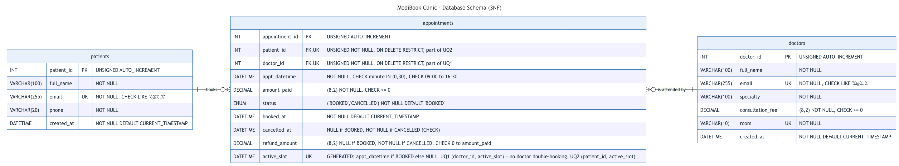

# MediBook: Clinic Appointment Booking API

Backend for a community clinic: patients book 30-minute slots with doctors (09:00 to 17:00, at most 12 appointments per doctor per day), cancel with a server-computed refund, join a waitlist when a slot or day is full, and the administrator gets statistics and reports.

**Stack:** Node.js, Express 5, MySQL 8 (`mysql2`, parameterized queries only, no ORM), Redis 7 (`ioredis`), Jest.

**Demo video:** <https://youtu.be/A3UwqYsShLg>

The original assignment brief is kept in [docs/assignment-brief.md](docs/assignment-brief.md).

---

## Contents

1. [Setup and running](#1-setup-and-running)
2. [Project structure](#2-project-structure)
3. [Database design](#3-database-design)
4. [API reference](#4-api-reference)
5. [Design decisions and justifications](#5-design-decisions-and-justifications) (Parts C, D, E)
6. [Testing](#6-testing)
7. [Demo walkthrough](#7-demo-walkthrough)
8. [Known limitations](#8-known-limitations)

---

## 1. Setup and running

### Prerequisites

- **Node.js 22 or newer** and npm
- **Docker Desktop** (runs MySQL and Redis). Alternatively, your own MySQL 8 and Redis 7 servers; see the note below.

### Steps

```bash
# 1. Install dependencies
npm install

# 2. Create your environment file (the defaults work with Docker as-is)
cp .env.example .env

# 3. Start MySQL and Redis and wait until both are healthy
docker compose up -d --wait

# 4. Create the tables and load the sample data
npm run db:setup

# 5. Start the web server  -> http://localhost:3000
npm start

# 6. In a SECOND terminal, start the background worker (waitlist + notifications)
npm run worker
```

Check it works: open <http://localhost:3000/api> (lists every endpoint) and <http://localhost:3000/feedback>.

> **Re-seed before every demo** with `npm run db:setup`. The seed uses dates relative to today (for example "3 days from now"), so upcoming appointments are always in the future.

> **Without Docker:** create an empty database and a user on your own MySQL 8 server, start Redis 7, then put their host, port and credentials in `.env`. `npm run db:setup` creates the tables.

### Environment variables (`.env.example`)

| Variable | Default | Purpose |
|---|---|---|
| `PORT` | `3000` | Web server port |
| `LOG_DIR` | `logs` | Folder for `audit.log` (created automatically) |
| `DB_HOST` / `DB_PORT` | `127.0.0.1` / `3306` | MySQL connection |
| `DB_NAME` / `DB_USER` / `DB_PASSWORD` | `medibook` / `medibook` / `change_me` | MySQL database and app user (Docker creates them) |
| `DB_TIMEZONE` | `+02:00` | Clinic time zone as a UTC offset. Used by MySQL sessions (`NOW()`, `CURDATE()`) and by the app for "future only", refunds and dates |
| `DB_ROOT_PASSWORD` | `change_me_root` | Only used by Docker to initialise MySQL |
| `REDIS_HOST` / `REDIS_PORT` | `127.0.0.1` / `6379` | Redis connection |

`.env` is git-ignored; only `.env.example` (placeholder values) is committed.

### npm scripts

| Script | What it does |
|---|---|
| `npm start` | Start the API server |
| `npm run dev` | Start the API with auto-restart (nodemon) |
| `npm run worker` | Start the background worker (a separate process) |
| `npm run db:setup` | Run `database/schema.sql` then `database/seed.sql` (`-- --no-seed` for schema only) |
| `npm test` | Run the Jest unit tests (no MySQL or Redis needed) |
| `npm run jobs:retry-failed` | Move dead-lettered jobs back onto their queues |

---

## 2. Project structure

```
├── database/
│   ├── schema.sql            DDL: 3 tables with all keys and constraints
│   ├── seed.sql              sample data (incl. zero-appointment doctor, near-cap day)
│   └── schema-diagram.mmd    source of schema-diagram.png (Mermaid)
├── schema-diagram.png        normalized schema diagram (Part A)
├── locales/                  en.json, fr.json for the feedback page (Part G)
├── requests/                 *.http files to try every endpoint (VS Code REST Client)
├── scripts/                  db-setup.js, retry-failed-jobs.js
├── tests/                    Jest unit tests
└── src/
    ├── server.js             starts the web server
    ├── worker.js             background worker (separate process)
    ├── app.js                Express app: routes + error middleware
    ├── config/               env, MySQL pool, Redis client, businessRules.js
    ├── routes/               URL + HTTP method -> controller (no logic)
    ├── controllers/          HTTP layer: validate input, call services/models, choose status
    ├── services/             business workflows: booking, cancellation, waitlist, refunds
    ├── models/               ALL SQL lives here (parameterized), plus the transaction helper
    ├── queues/               Redis keys, reliable job queue, waitlist lists
    ├── validators/           pure validation functions (unit tested)
    ├── middleware/           central error handler, 404 handler
    ├── views/                feedback page HTML
    └── utils/                HttpError, audit logger, clinic time, i18n
```

**Layer rules followed throughout:** SQL appears only in `src/models/`; every statement uses `?` placeholders (the only dynamic SQL, the column list of a partial `UPDATE`, comes from a fixed whitelist in `sqlHelpers.js`, never from request data); routes contain no logic; every business value (12-slot cap, working hours, refund tiers, 80% threshold) is defined once in [src/config/businessRules.js](src/config/businessRules.js).

---

## 3. Database design



Exactly three tables, normalized to 3NF. The original spreadsheet repeated patient details (Ama Mensah appears twice) and doctor details (Dr. Boateng twice), so those moved into `patients` and `doctors`. `appointments` keeps only facts about the booking and links the two with foreign keys (each patient and each doctor has 0..N appointments). `appt_ref` was dropped as it is derivable from the primary key.

`amount_paid` is **not** redundant with `consultation_fee`: it is what was paid at booking time (AP-002 paid 120.00 against a fee of 150.00), and a fee can change later without rewriting history.

| Rule | Where it is enforced |
|---|---|
| A doctor cannot have two appointments at the same date/time | `UNIQUE (doctor_id, active_slot)` |
| A patient cannot be in two appointments at the same time | `UNIQUE (patient_id, active_slot)` |
| A cancelled slot can be booked again, while the cancelled row is kept | `active_slot` is a **generated column**: `appt_datetime` while `BOOKED`, `NULL` once `CANCELLED`. A unique index allows many NULLs, so cancelled rows never block the slot |
| Slots start on :00 or :30, between 09:00 and 16:30 | `CHECK` constraints on `appt_datetime` |
| Cancellation and refund recorded together | `CHECK`: `BOOKED` means `cancelled_at` and `refund_amount` are NULL; `CANCELLED` means both are set |
| Refund between 0 and the amount paid; fees and payments non-negative | `CHECK` constraints |
| Unique emails; one doctor per room | `UNIQUE` constraints |
| History cannot be deleted | Foreign keys `ON DELETE RESTRICT` (deleting a patient or doctor with appointments returns 409) |

Money uses `DECIMAL(8,2)`; slots use `DATETIME`. Two rules cannot be `CHECK` constraints and are enforced in the application: "future only" (MySQL forbids `NOW()` in a CHECK) and the 12-per-day cap (it counts across rows); see section 5.

---

## 4. API reference

Base URL `http://localhost:3000`. Request and response bodies are JSON. Errors always look like `{ "error": { "message": "...", "details": [...] } }`.

| Method | Path | Purpose | Success | Errors |
|---|---|---|---|---|
| GET | `/api` | List endpoints | 200 | |
| GET / POST | `/api/patients` | List / create patient | 200 / 201 | 400, 409 duplicate email |
| GET / PATCH / DELETE | `/api/patients/:id` | Read / partial update / delete | 200 / 200 / 204 | 400, 404, 409 has history |
| GET / POST | `/api/doctors` | List / create doctor | 200 / 201 | 400, 409 email or room taken |
| GET / PATCH / DELETE | `/api/doctors/:id` | Read / partial update / delete | 200 / 200 / 204 | 400, 404, 409 has history |
| GET | `/api/doctors/:id/stats` | Revenue, upcoming count, next 7 days per day, utilization | 200 | 400, 404 |
| POST | `/api/appointments` | Book `{ patient_id, doctor_id, appt_datetime }` | 201 | 400 malformed, 404, **409** slot taken / day full (with waitlist offer) / patient busy, **422** past, outside hours, not on :00/:30 |
| GET | `/api/appointments/:id` | Read one appointment | 200 | 400, 404 |
| DELETE | `/api/appointments/:id` | Cancel; response states the refund | 200 | 400, 404, 409 already cancelled, 422 already started |
| POST | `/api/waitlist` | Join waitlist (same body as booking) | 201 | 400, 404, 409 slot available / already waiting, 422 |
| GET | `/api/waitlist?doctor_id=&date=` | Who is waiting that day | 200 | 400 |
| GET | `/api/reports/doctors` | Every doctor's totals and revenue (incl. zero) | 200 | |
| GET | `/api/reports/busy-days` | (doctor, date) with more than 80% of 12 slots booked | 200 | |
| GET / POST | `/feedback?lang=en\|fr` | Course feedback page (HTML) | 200 | unsupported `lang` falls back to English |

`appt_datetime` is clinic local time, `YYYY-MM-DDTHH:MM` (e.g. `2026-11-25T09:30`). Ready-made requests for every row are in [requests/](requests/).

---

## 5. Design decisions and justifications

### Part C: API and business rules

**REST design.** Resources are plural nouns (`/patients`, `/doctors`, `/appointments`, `/waitlist`); HTTP methods carry the action. Updates use `PATCH` (partial) rather than `PUT`, so a client can change one field. Statistics are a sub-resource of a doctor (`/doctors/:id/stats`); cross-doctor reports live under `/reports`. Cancelling is `DELETE /appointments/:id` because, for the client, the booking is removed; the row itself is kept (soft delete) for refund history, and the response is `200` with a body (not `204`) because it must state the refund.

**Status codes.** `400` = the request is malformed (wrong types, unknown fields, unparseable date), with a list of every problem. `422` = well-formed but breaks a rule regardless of current data (09:15, 17:00, a past time). `409` = valid but conflicts with the current state (slot taken, day full, duplicate email, deleting a record with history, cancelling twice). `404` = unknown id. One central middleware ([errorHandler.js](src/middleware/errorHandler.js)) turns every error into JSON and maps MySQL errors using the constraint names (e.g. `uq_doctors_room` → 409 "room already assigned").

**Booking rules** ([bookingService.js](src/services/bookingService.js)):

- *Future, working hours, 30-minute boundary:* checked by a pure function, `validateAppointmentSlot` (unit tested), in clinic time. The database CHECKs repeat the hour and boundary rules as a safety net.
- *Never more than 12 per day, and never two patients in one slot, even when requests arrive at the same instant:* each booking runs in a transaction that **first locks the doctor's row** with `SELECT ... FOR UPDATE`. Concurrent bookings for the same doctor therefore run one after another: the second one only counts after the first has committed, so it sees 12 and gets `409`. Bookings for different doctors do not block each other. The transaction uses `READ COMMITTED` so the count after waiting for the lock includes rows committed meanwhile (the default `REPEATABLE READ` can read an older snapshot). The `UNIQUE (doctor_id, active_slot)` index is a second line of defence.
- *Evidence:* 20 simultaneous requests for one slot gave 1 × `201` and 19 × `409`. With 11/12 booked, 5 simultaneous requests for different free slots gave 1 × `201` and 4 × `409`. With the lock temporarily removed, the same test created 5 bookings (16 of 12), showing the lock is what enforces the cap.
- *Price:* `amount_paid` is copied from the doctor's fee on the server; a client-supplied amount is rejected as an unknown field.

**Cancellation and refund** ([cancellationService.js](src/services/cancellationService.js), [refundPolicy.js](src/services/refundPolicy.js)):

- The refund is computed on the server from the notice given (hours between now and the appointment). The client only sends the id.
- **Boundary policy:** more than 48 h → **100%**; from 24 h up to and including 48 h → **50%** (so *exactly 48 h* is 50%, because it is not "more than 48", and *exactly 24 h* is 50%); less than 24 h → **0%**. Amounts are calculated in whole cents (50% of 120.55 = 60.28, not 60.27).
- **Succeed or fail together:** the row is locked, then one `UPDATE` sets `status = 'CANCELLED'`, `cancelled_at` and `refund_amount` in a single statement inside the transaction. The CHECK constraint makes a cancellation without a refund record impossible. Three simultaneous cancels of one appointment give one `200` and two `409`.
- **Slot becomes bookable, record kept:** setting the status to `CANCELLED` turns `active_slot` into NULL, which releases the unique slot; the row stays with its refund.
- Cancelling an appointment that has already started returns `422`. After the commit, the cancellation notifies the waitlist (Part E).

**Statistics and reports** ([reportModel.js](src/models/reportModel.js)): every figure is produced by SQL, not JavaScript.

- *Revenue collected* = `SUM(amount_paid - COALESCE(refund_amount, 0))`: booked appointments count in full (paid at booking); cancelled ones count what was not refunded. Defined once and used by both reports.
- *Doctor stats:* a **recursive CTE** generates the next 7 calendar days so days with no appointments still appear; per-day utilization is `count / 12`, and a **window function** (`SUM(COUNT(...)) OVER ()`) gives utilization for the whole 7-day period.
- *Doctors report:* `doctors LEFT JOIN appointments` with conditional aggregation, so a doctor with zero appointments appears with zeros.
- *Busy days:* `GROUP BY doctor, date` with `HAVING COUNT(*) / 12 > 0.8` (strictly more than 80%: 10/12 is busy, 9/12 is not). Only active bookings count.

### Part D: audit log

[auditLogger.js](src/utils/auditLogger.js) appends one JSON object per line to `logs/audit.log` with `fs/promises` (`mkdir` + `appendFile`). There are no `*Sync` calls in the application.

- **Directory created on first run:** `mkdir(logDir, { recursive: true })` before the first write (cached; retried if it failed).
- **Only successful operations are logged:** the log call sits in the booking and cancellation services *after* the transaction commits, so failed or rejected requests never produce a line. Because it is in the service, bookings made by the worker (waitlist promotions) are logged too.
- **A logging failure never fails the request:** `logEvent()` catches its own errors and prints a warning; it is not awaited, so the response never waits for the disk. Tested by replacing `logs/` with a plain file: the booking still returned `201`.
- Events: `APPOINTMENT_BOOKED`, `APPOINTMENT_CANCELLED` (with the refund), `WAITLIST_JOINED`, `WAITLIST_PROMOTED`, `CONFIRMATION_SENT`, plus failure events.

### Part E: queues, worker and Redis

**Waitlist.** A full slot or day returns `409` with a waitlist offer; the patient joins with `POST /api/waitlist` (same body). Waitlists are Redis lists (first in, first out):

- slot taken (day not full) → `waitlist:slot:<doctor>:<datetime>`: waits for that exact slot;
- day full (12/12) → `waitlist:day:<doctor>:<date>`: waits for any slot freed that day.

Duplicates are rejected (`LPOS`), and lists expire when the slot or day has passed.

**Worker, a separate process** ([src/worker.js](src/worker.js), `npm run worker`). After a cancellation commits, the API pushes a job to `queue:promotions`. The worker takes the first waiting patient (exact-slot waiters first, then whole-day waiters) and books them by calling **the same `bookAppointment()`** as the API, so the lock, the 12-per-day cap, the audit log and the confirmation all apply.

**What if the promoted booking fails? The patient is never lost.** The worker never *pops* a patient. It atomically **moves** them (`LMOVE`) from the waitlist to `waitlist:processing`, so at every moment the patient is in the waitlist, in processing, or in the appointments table:

| Failure | Handling |
|---|---|
| Booking succeeds | Removed from processing |
| Slot was taken directly in the meantime, or the day filled | Moved **back to the front** of the waitlist; stop |
| This patient already has an appointment at that time | Skipped but **keeps their place**; the next patient is tried |
| Patient no longer exists | Entry removed (logged) |
| Database or Redis error | Moved back to the front, and the **job is retried** (3 attempts, then `queue:promotions:failed`; `npm run jobs:retry-failed` re-queues it) |
| Worker crashes mid-booking | On start-up the worker moves everything left in processing back to the front |

The decision table is a pure, unit-tested function ([promotionOutcome.js](src/services/promotionOutcome.js)). Tested end to end: with MySQL stopped the job failed 3 times and was dead-lettered while the patient stayed first in the waitlist; after restarting MySQL and re-queuing, the patient was booked.

Jobs themselves use the same reliable pattern: `BLMOVE` to `<queue>:processing`, removed only after success. Redis runs with append-only persistence (`--appendonly yes`), so waitlists and jobs survive a Redis restart.

**Notification jobs.** Every confirmed appointment (direct or promoted) enqueues an `APPOINTMENT_CONFIRMED` job on `queue:notifications`. The worker builds the SMS/email text and writes it to the audit log as `CONFIRMATION_SENT`. It uses a strict write that throws on failure, so a failed write is retried rather than silently dropped.

**Redis outages do not break the API.** If Redis is down, bookings and cancellations still succeed (they are already committed in MySQL); the failed enqueue is reported and logged (`CONFIRMATION_ENQUEUE_FAILED`, `WAITLIST_NOTIFY_FAILED`). See limitations.

---

## 6. Testing

```bash
npm test
```

74 Jest unit tests, none of which need MySQL or Redis (business rules are pure functions; "now" is passed in, so tests use fixed dates):

| Test file | Covers |
|---|---|
| `refundPolicy.test.js` | All three tiers, **exactly 48 h → 50%**, **exactly 24 h → 50%**, one minute either side, cent rounding |
| `slotValidator.test.js` | 09:00 and 16:30 accepted; **17:00**, 08:30, **09:15**, `:30` seconds, past times, clinic time zone, malformed dates (`2026-02-30`, `25:00`, `tomorrow`) |
| `fieldValidator.test.js` | Required/unknown fields, max length edge, money limits, partial updates, id parsing |
| `bookingValidator.test.js` | 400 vs 422 classification, client price rejected |
| `promotionOutcome.test.js` | Every waitlist promotion failure case |
| `auditLogger.test.js` | Directory auto-created, JSON lines appended, failure never thrown |
| `i18n.test.js` | Locale fallback (`de`, empty, repeated `lang`), 5 questions per locale, dates in both languages, HTML escaping |

---

## 7. Demo walkthrough

Recorded demo: <https://youtu.be/A3UwqYsShLg>

After `npm run db:setup` (ideally after 10:00, so the refund tiers below land as described), with `npm start` and `npm run worker` running:

1. **Booking rules** ([requests/appointments.http](requests/appointments.http)): book a slot (`201`), then try 09:15, 17:00 and a past date (`422`). Dr. Boateng (doctor 1) has 11/12 slots three days from today: book the 12th (`201`), the 13th gets `409 DAY_FULL` with a waitlist offer.
2. **Waitlist promotion** ([requests/waitlist.http](requests/waitlist.http)): join the waitlist, cancel appointment 5 (Boateng 09:00), and watch the worker terminal book the waitlisted patient; `GET /api/waitlist` is now empty.
3. **Refunds:** cancel appointment 16 (tomorrow: 0%), 17 (in 2 days: 50%), 18 (in 5 days: 100%).
4. **Reports** ([requests/reports.http](requests/reports.http)): doctor stats, doctors report (Dr. Owusu-Ansah with zeros), busy days (11/12 and 10/12 listed, 9/12 not).
5. **Audit log:** `logs/audit.log` shows bookings, cancellations, promotions and confirmation messages.
6. **Feedback page:** <http://localhost:3000/feedback>, then `?lang=fr`, then `?lang=de` (falls back to English).

---

## 8. Known limitations

- **Missed notifications while Redis is down.** A booking or cancellation committed while Redis is unreachable cannot enqueue its job; the failure is logged but the job is not retried automatically. The standard fix is a transactional *outbox* table written in the same MySQL transaction, which the 3-table limit of this assignment does not allow.
- **One worker process is assumed.** Multiple workers would be safe for jobs, but promotions for the same slot could run concurrently; a per-doctor Redis lock would be needed to scale out.
- **Fixed UTC offset.** `DB_TIMEZONE` is an offset (Rwanda has no daylight saving time). A clinic in a zone with DST would need a named time zone loaded into MySQL.
- **No authentication**, as it was out of scope for the brief.
